# Pawpath

A small outdoor adventure, with a companion who remembers it.

Pawpath is a web app that pairs you with a fictional pixel creature, rewards recorded walks, and turns things you notice outside into private field notes. Gemma runs in a supported computer browser; your phone can use that computer's model through the deployed app.

**[Try Pawpath](https://pawpath.onrender.com)** · **[Source code](https://github.com/RishabhVoid/pawpath)** · **[Hacktoberfest report](docs/Hacktoberfest-Report.md)**

Built for the [Hacktoberfest 2026 Week 1: Touch Grass challenge](https://dev.to/challenges/hacktoberfest-week1-2026-10-05).

## A real walk

The October 12 phone demo recorded **76 metres in three minutes**, earned **7 XP**, saved an outdoor discovery, and kept Macha's bandana equipped. These are results from one short outing, rather than a GPS accuracy benchmark.

| Walking | Field notes | Walk complete |
| --- | --- | --- |
| 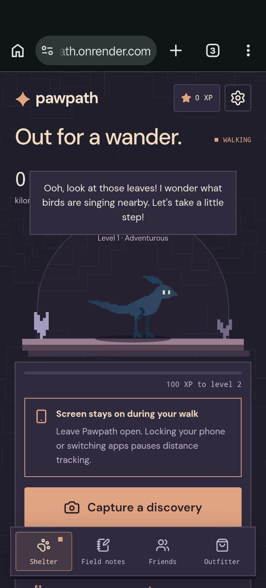 | 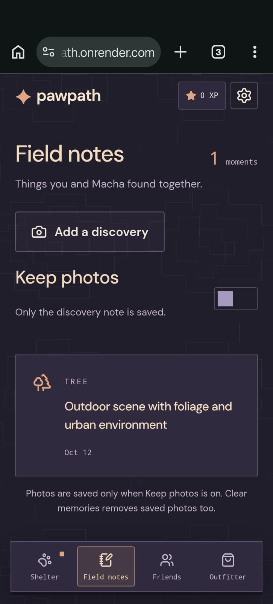 | 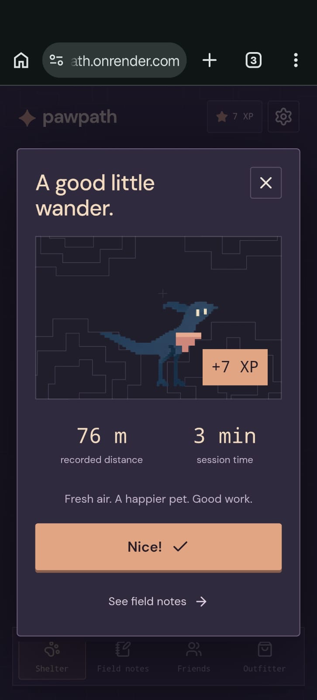 |

## Outfits, Shelter, and companion chat

| Outfitter | Back at the Shelter |
| --- | --- |
| 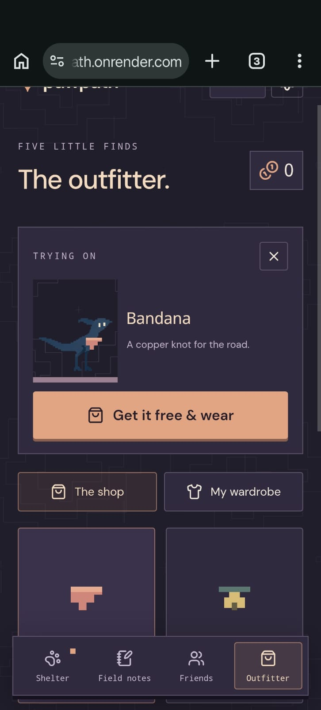 | 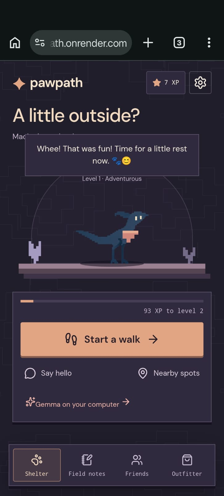 |

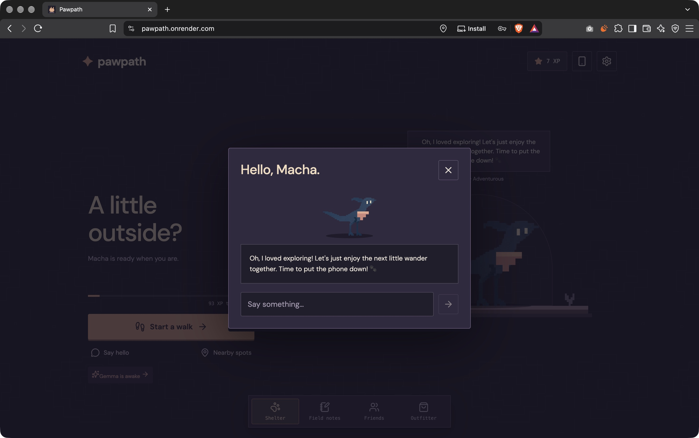


## Desktop feature tour

The same account brings the phone outing back to the computer: Field notes shows both the walk and discovery, and My wardrobe shows the owned bandana. Friends below is the current empty club with its invite flow.

| Field notes and walk memories | Friends |
| --- | --- |
| 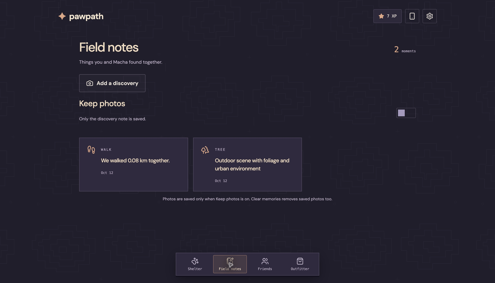 | 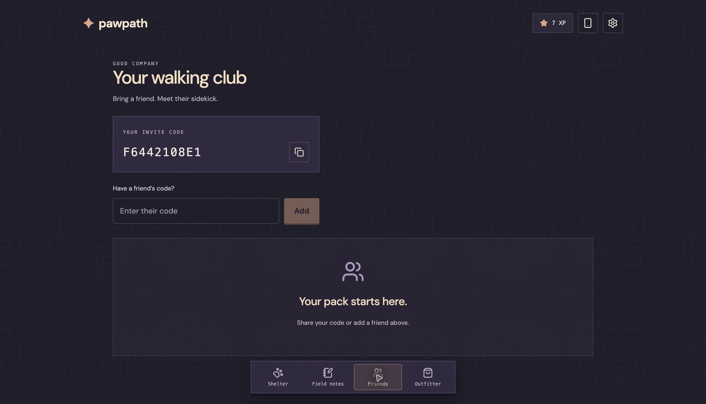 |

| All five shop accessories | Owned wardrobe |
| --- | --- |
| 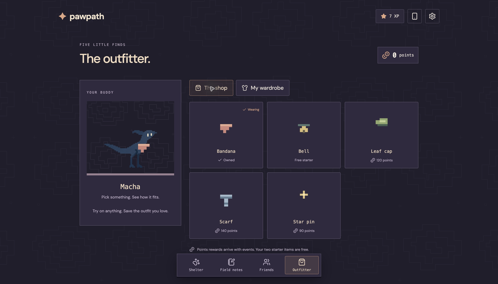 | 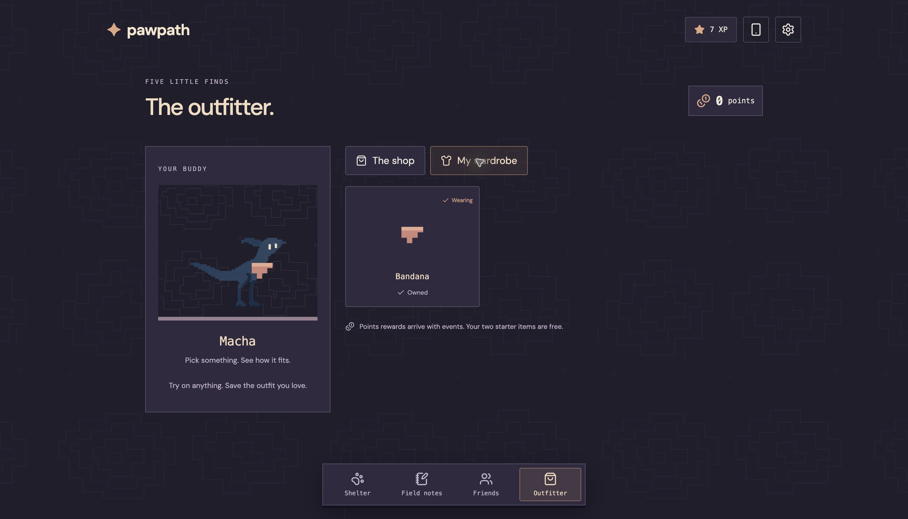 |

| Companion profile | Ten-creature guide |
| --- | --- |
| 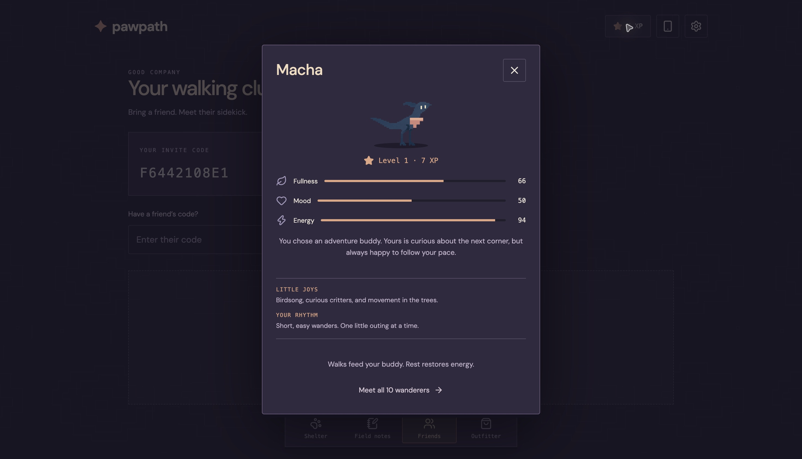 | 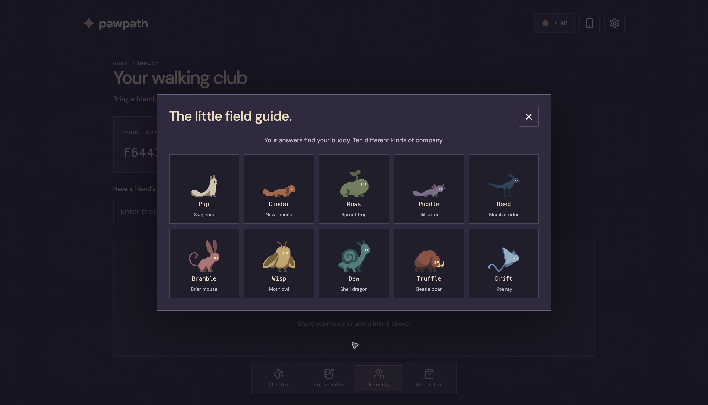 |

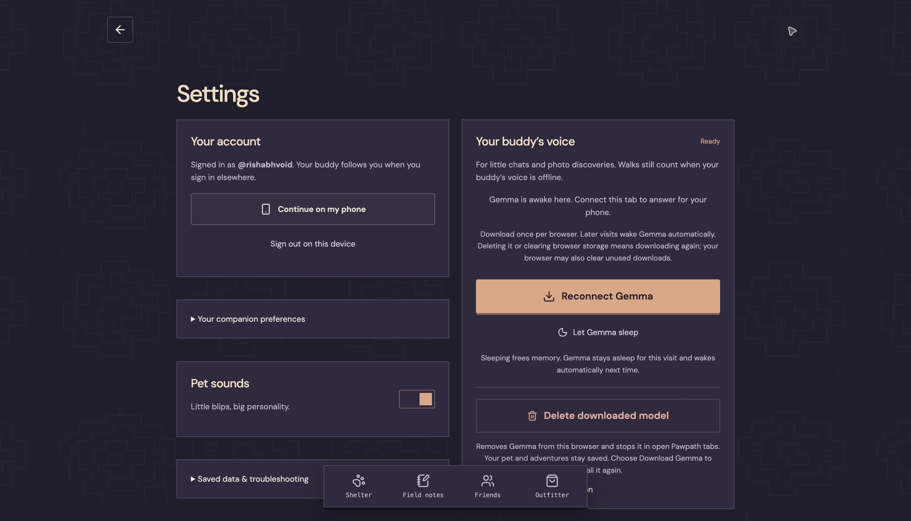

## What you can do

- Match with one of ten companions using your walking rhythm, interests, and preferred personality; browse all ten in the creature guide and inspect fullness, mood and energy in your profile.
- Record a GPS walk, earn one XP per ten recorded metres, and improve your pet's fullness and mood.
- Photograph an outdoor discovery; Gemma produces a short label and category for Field notes.
- Ask your companion a question, with relevant saved discoveries retrieved into its context.
- Continue the same account and journey on a phone using a short-lived, single-use QR.
- Find nearby parks, paths, and waterside spots, or follow your own route.
- Add friends through reciprocal invite codes and see their public pet cards.
- Manage pet sounds, companion preferences and the downloaded model in Settings.
- Try on and equip accessories. The bandana and bell are free; three other items use a separate points wallet. Earning those points through events is not implemented yet.

## Try the demo

1. Open the [HTTPS app](https://pawpath.onrender.com) and create your own username/password account. Complete the short companion setup.
2. On a supported computer, open the Gemma controls and download the model once. Allow several GB of browser storage; the interface estimates about 3.4 GB. Wait for loading and warmup to finish.
3. Keep that tab open and the computer awake. Start a walk there to prepare a phone journey QR, or sign into the same account on your phone.
4. Scan the QR and tap **Allow location & start** on the phone. Keep Pawpath visible and the phone awake while walking.
5. Capture a discovery, visit Field notes, then finish the walk to see distance and XP. You can claim the free bandana in Outfitter.

Phones and tablets use the computer host instead of downloading this model. The two devices need internet but do not need the same Wi-Fi network when using the deployed HTTPS app. Walking and account features remain available without an awake AI host; chats and photo understanding require it.

## How it works

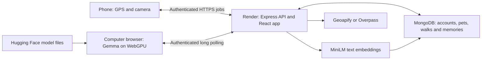

The client uses React, Vite, TypeScript, and Lucide icons. The Node/Express server serves both the production client and API from one origin. Zod validates requests and model responses.

The browser worker runs `onnx-community/gemma-4-E2B-it-ONNX` through Transformers.js, using `q4f16` weights and WebGPU. Downloads are pinned to a revision and cached per browser/site. Complete cached models can wake automatically on later visits; missing weights require an explicit download.

The server embeds discovery text with `Xenova/all-MiniLM-L6-v2` into normalized 384-dimensional vectors. Production supports Atlas Vector Search with a pet ownership filter. If the index is unavailable, recall falls back to similarity over up to 500 stored vectors for that pet. If embeddings fail, the saved personality still works without discovery recall.

## Privacy and account boundaries

Passwords use salted scrypt hashes, and session credentials are stored as hashes. QR handoffs expire after two minutes and can be claimed once. A walk has one tracking device at a time; completion rewards are issued once.

Walk storage uses totals and rounded location cells rather than raw GPS trails. **Keep photos** defaults off. When enabled, discovery photos are resized JPEGs, limited to 50 per pet and 150 KB each, fetched through owner-checked endpoints. Original camera files are not saved. Clearing memories or deleting an account removes its saved photos.

Phone inference inputs pass through Render's HTTPS relay before reaching your computer. Local Gemma execution does not make this a fully offline app or keep all inputs off the server. Nearby-place lookups also contact external providers.

## Run locally

Use **Node 24**, **pnpm**, and a running MongoDB instance. The package declares Node 22.12 or newer; Node 24 matches the deployment and CI.

```sh
pnpm install --frozen-lockfile
pnpm warmup
pnpm dev
```

Open `http://localhost:5173`; Vite forwards API calls to port 3001. The default database is `mongodb://127.0.0.1:27017`, database `pawpath`.

Configure server process variables through your shell or hosting dashboard. Keep credentials out of Git and browser code.

| Variable | Purpose |
| --- | --- |
| `MONGODB_URI` | MongoDB connection; required for durable production storage |
| `MONGODB_DATABASE` | Database name; defaults to `pawpath` |
| `GEOAPIFY_API_KEY` | Optional preferred nearby-place provider; otherwise Overpass is used |
| `PAWPATH_OFFLINE` | `true` prevents remote server embedding-model downloads once warmed |
| `PORT` | API port; supplied by Render in production |
| `OLLAMA_URL`, `GEMMA_LOCAL_MODEL` | Optional developer Ollama connection; normal players do not need it |

Phone GPS needs HTTPS. A local HTTP LAN address can load account data but cannot provide the normal outdoor phone tracking flow.

## Deploy and verify

The included `render.yaml` deploys one Node Web Service for the client and API. Configure MongoDB Atlas and optional Geoapify credentials in the Render dashboard. The build performs release checks and warms the server embedding model; the start command is `node dist-server/server/index.js`, with `/api/health` as its health check.

The `pet_memories` Vector Search index uses `embedding`, 384 dimensions, cosine similarity, and a `petId` filter. The live health check on October 12 reported `storage: "mongodb"`, `localBrain: false`, and `vectorReady: true`. `localBrain: false` is expected for production browser-hosted Gemma.

```sh
pnpm check:release
```

The release workflow runs type checking, core/relay tests, builds, and production tests, followed by embedding warmup checks. During the October 12 documentation review, **78 existing tests passed** and **type checking passed**. Production tests used the existing built client; this documentation update did not rebuild the app. GPU workers and database services are simulated in automated tests, so these checks do not establish hardware compatibility or long-term Atlas persistence.

[Successful GitHub Actions release run](https://github.com/RishabhVoid/pawpath/actions/runs/38210000157).

## Current limits

- Browser GPS pauses when the phone locks or Pawpath is hidden. Screen wake lock helps, but native background location is not implemented.
- Gemma needs a compatible computer GPU, WebGPU half-precision support, browser storage, and an awake host tab. Downloading is substantial; inference speed depends on hardware.
- Render's relay holds jobs in process memory and supports one service instance. Restarts clear jobs; multiple replicas need shared signaling or routing.
- Free Render services can sleep after inactivity and take time to wake. See [Render's free-service limits](https://render.com/docs/free).
- Discovery labels can be broad or incorrect. One successful outdoor note does not measure vision accuracy; a live recall question produced a general reply rather than a specific discovery recap.
- Password recovery, friend messaging, quests, growth traits, and event-based shop-point earning are not implemented.
- The current app needs its account server and internet. Cached app/model assets do not make the whole phone journey offline.
- DigitalOcean-hosted Gemma is a possible future option; the current build uses the user's GPU to avoid recurring hosted inference costs.

## License and credits

Application code is [MIT licensed](LICENSE). Model/runtime and font assets retain their respective licenses. Gemma is by Google DeepMind; the browser conversion is published by ONNX Community on [Hugging Face](https://huggingface.co/onnx-community/gemma-4-E2B-it-ONNX). Transformers.js is by Hugging Face. Nearby data comes from Geoapify/OpenStreetMap providers where used.

Companion art comes from original AI-assisted sprite studies documented during development; accessories are pixel SVG overlays. Bundled DM Sans/DM Serif license notices should remain with their assets. Codex assisted the implementation audit and this documentation.
