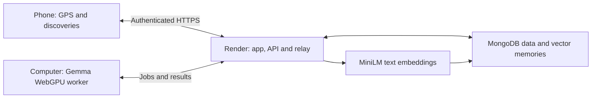

*This is a submission for the [Hacktoberfest Open-Source AI Challenge Week 1: Touch Grass](https://dev.to/challenges/hacktoberfest-week1-2026-10-05).*

## What I Built

When I was younger, I played Talking Tom. I remember its notifications making me feel guilty about leaving my virtual pet alone. That little feeling could pull me straight back into the app.

For this challenge, I wanted to send that feeling somewhere useful: **outside**.

I built **Pawpath**, a walking companion where caring for a virtual creature means taking it into the real world. A little guilt trip, aimed at getting you out for a walk.

Rain World is my favourite game, and it gave me the visual direction: strange little creatures, a moody palette, and a world you want to wander through. Pawpath's companion designs are original, with Rain World as the aesthetic inspiration.

My companion is **Macha**, an adventurous marsh strider. A short setup matches your walking rhythm, interests, and preferred personality to one of ten pixel creatures. Recorded walks feed your companion, improve its mood, and earn XP. Gemma gives it a voice and helps turn things you photograph outside into discoveries it can remember.

That emotional nudge lives in the pet's state and its short invitations to walk. I wanted the feeling of a buddy waiting for you, without having it insult you for staying inside. The companion prompt keeps that boundary explicit:

```text
Speak in first person, never guilt or shame.
Reply in fewer than 25 words. Encourage putting the phone away.
Never claim a walk or discovery happened unless provided.
```

The little tug comes from caring about the creature. Its dialogue should still be kind.

## Demo

**[Take a look at Pawpath](https://pawpath.onrender.com)**

I took Macha outside for a short phone test. The app recorded **76 metres in three minutes** and awarded **7 XP**. A small walk was enough to try the whole loop: head outside, notice something, save it, and come back to a happier pet.


I captured an outdoor discovery, and Gemma labelled it “Outdoor scene with foliage and urban environment,” under the tree category. It became a dated entry in **Field notes**.


The label is fairly broad. It worked as a small memory of the outing; it did not demonstrate precise plant identification. **Keep photos** was off, so the discovery note was saved without retaining the picture.


The reward is deliberately simple: `floor(recorded_metres / 10)`. That is how 76 metres became 7 XP. Back at the Shelter, Macha had 93 XP left to level 2 and was wearing the free bandana from the Outfitter.


### The rest of the companion's world

The walk is the centre of Pawpath, but I wanted the creature to feel like someone you come home to. All four main areas work on desktop and phone:

| Area | What you can do |
| --- | --- |
| **Shelter** | See your companion, level and XP; open its profile for fullness, energy and mood; start or finish a walk; say hello; find nearby spots; manage Gemma. |
| **Field notes** | Revisit dated discoveries and completed walks, add another discovery, and choose whether resized photos are kept. The desktop journal now shows both my tree discovery and our 0.08 km outing. |
| **Friends** | Share an invite code, add a friend by theirs, and meet their companion through a public pet card. Location, private memories and walking preferences stay private. |
| **Outfitter** | Browse five accessories, try them on your actual companion, claim the free starters, and switch to **My wardrobe** to equip or remove owned items. |

**Memories on desktop.** The same journal follows the account across devices. Here are the walk and discovery together, with photo retention still off.


**Friends.** This is my current walking club, ready for its first friend. Sharing codes connects companion cards; it does not expose the outdoor journal or location. Friend messaging is still unfinished.


**The shop and My wardrobe.** One view is for exploring outfits; the other is for the pieces your companion already owns.


The Outfitter has a bandana, bell, leaf cap, scarf and star pin. The bandana and bell are free. The other three use a separate points wallet; event-based point earning is unfinished, so I am showing the free outfit I actually own.


Beyond those tabs, onboarding matches walking rhythm, favourite outdoor discoveries and company style to one of ten creatures. Nearby spots can suggest a park, path or waterside destination, with an own-route option. The profile also opens a creature guide. Account settings include pet sounds, companion preferences and controls for clearing memories, signing out or deleting the account; Gemma controls manage loading, sleeping and its cached model. The phone-continuation QR connects the desktop setup to the actual outdoor journey.

| Macha's profile | All ten wanderers |
| --- | --- |
|  |  |

### Trying it yourself

Create your own account on the [HTTPS app](https://pawpath.onrender.com) and complete the companion setup. On a compatible computer, open the Gemma controls, download the model once, and wait for warmup. Keep that tab and computer awake.

Starting a walk on the computer prepares a phone journey QR. Scan it, tap **Allow location & start**, and walk with Pawpath visible on your phone. You can select a nearby spot or follow your own route. The two devices need internet but do not need the same Wi-Fi network.

Allow roughly **3.4 GB** for the initial model download and use a computer with compatible WebGPU hardware. The phone uses that computer's model. Walking and account features are available without an awake AI host; chats and discovery-photo understanding require one.

## Code

**[Pawpath on GitHub](https://github.com/RishabhVoid/pawpath)** — application code is MIT licensed.

The [README](https://github.com/RishabhVoid/pawpath#readme) covers setup, screenshots, deployment, and current limits. The app has four main areas: Shelter, Field notes, Friends, and Outfitter. Friends share public pet cards through reciprocal invite codes. Outfitter has five accessories, including two free starters; earning points for the other three through events is still unfinished.

## How I Built It

Pawpath uses React, Vite, TypeScript, Express, MongoDB, Zod, and Transformers.js. Render serves the client and API from one HTTPS origin.

The main engineering problem was getting **a model on my computer to accompany a walk on my phone**.

### Leave the model at home

The computer runs [Gemma 4 E2B](https://huggingface.co/onnx-community/gemma-4-E2B-it-ONNX) through Transformers.js in a WebGPU worker, using quantized `q4f16` weights pinned to a specific revision. It handles text and image requests, with short replies and bounded generation.

The download happens explicitly. Complete cached weights can wake automatically on later visits, but missing files do not silently start another large download. The model must finish a real warmup before the interface declares it ready.


The signed-in computer becomes the account's AI host. Render relays authenticated phone jobs over HTTPS, and the computer polls for work and returns the answer. Gemma executes on the user's GPU; Render hosts the app, API, and relay. The normal flow needs no Ollama installation, tunnel, or helper script.



This choice kept a recurring hosted-model bill out of the project. It also introduced a very real limitation: the computer needs to stay awake while its companion is out walking.

### Give the creature a memory

A discovery produces a short label and category, which are saved as text. The server embeds that text using `Xenova/all-MiniLM-L6-v2` into normalized, 384-dimensional vectors. The MongoDB integration supports Atlas Vector Search, filters by companion ID, and retrieves up to three relevant memories for the pet prompt.

If the index is unavailable, retrieval can compare stored vectors for that pet. If embeddings fail, the saved personality still works without discovery recall. Onboarding preferences are also included directly in the prompt.

Photos have a separate retention choice. **Keep photos** defaults off. Opting in stores resized private JPEGs, with a limit of 50 per pet and 150 KB each. Original camera files are not saved.

### Keep the game rules in code

Gemma provides the personality and photo interpretation. Code handles the rewards and account boundaries.

Walks are checkpointed, have one tracking device at a time, and receive completion rewards once—even if an end request is repeated. A two-minute, single-use QR lets the phone continue the account and journey without copying model weights or a permanent password.

GPS filtering rejects poor accuracy, stationary noise, implausible speed, and long gaps. Nearby spots come from Geoapify or Overpass, and model-selected destinations are checked against real candidates. The pet cannot invent a new destination and have it accepted as a provider result.

### What worked, and what still needs testing

The documentation review passed **78 existing tests** and TypeScript checking. Tests cover accounts, QR claims, phone relay permissions, duplicate rewards, GPS filters, private photos, retrieval fallback, and production assets. GPU workers and database services are simulated in those tests.

The deployed API reported MongoDB storage and vector readiness. Two public GitHub Actions release checks also passed, including [this run](https://github.com/RishabhVoid/pawpath/actions/runs/38210000157).

There was a real Gemma response in Brave too:


When asked what we noticed on the walk, the companion gave a general invitation to another outing rather than naming the foliage discovery. Inference worked; precise recall still needs repeated tests. The 76-metre outing likewise shows a working walk loop, rather than establishing GPS accuracy across devices and routes.

## Why Does Open Innovation Matter?

Open weights made this architecture possible. I can run the actual companion model on a user's GPU, inspect and change its prompts, pin the files, and work on a different inference path later. Transformers.js and the ONNX conversion make that accessible through the browser.

That matters for a small project built under budget constraints. Every chat and photo does not need a metered hosted Gemma request. There are still costs—hardware, electricity, storage, downloads, and the services behind the app—but I can keep experimenting without paying for a model call each time.

It also lets me decide how much an adventure needs to remember. A small text discovery can be enough. A photo archive is optional.

Local execution is only part of the privacy story, though. Phone inputs pass through Render's relay; accounts and memories live in MongoDB. The deployed phone journey needs internet and is not fully offline.

### The part I would change next

My childhood Talking Tom memory gave me the motivation for Pawpath. Taking Macha outside showed me the main obstacle to that idea: **the phone still needs to stay awake with Pawpath visible**.

Locking it or switching apps pauses browser GPS. A wake lock helps with auto-lock, but native background-location support would let this companion come along while the phone stays in a pocket. That is the next change I would want most.

Hosting Gemma on a DigitalOcean GPU service could also remove the awake-computer requirement. Recurring GPU costs did not fit the current budget, so it remains a future option. The current relay supports one Render instance and loses pending work on restart; shared queues or signaling would be needed to scale it. Password recovery, event-point earning, and broader vision/recall evaluation are still on the list.

For now, I have a little creature that got me outside for three minutes. That is a small result, but it is the direction I wanted that old virtual-pet feeling to take.

## Prize Categories

- **Best Use of Render:** hosting the app/API and the authenticated phone-to-computer inference relay.
- **Best Use of Gemma:** browser-local Gemma 4 E2B for companion conversations and outdoor-photo understanding.
- **Best Use of MongoDB Atlas:** the documented production data layer and pet-scoped vector-memory integration; the live API reports MongoDB storage and vector readiness.
- **Best Use of GitHub Copilot:** the category's GitHub Actions automation option, with successful release-check runs. The evidence here is Actions automation.

These claims follow the [Week 1 category descriptions](https://dev.to/challenges/hacktoberfest-week1-2026-10-05).
